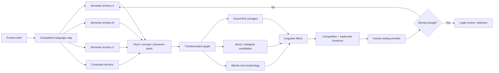
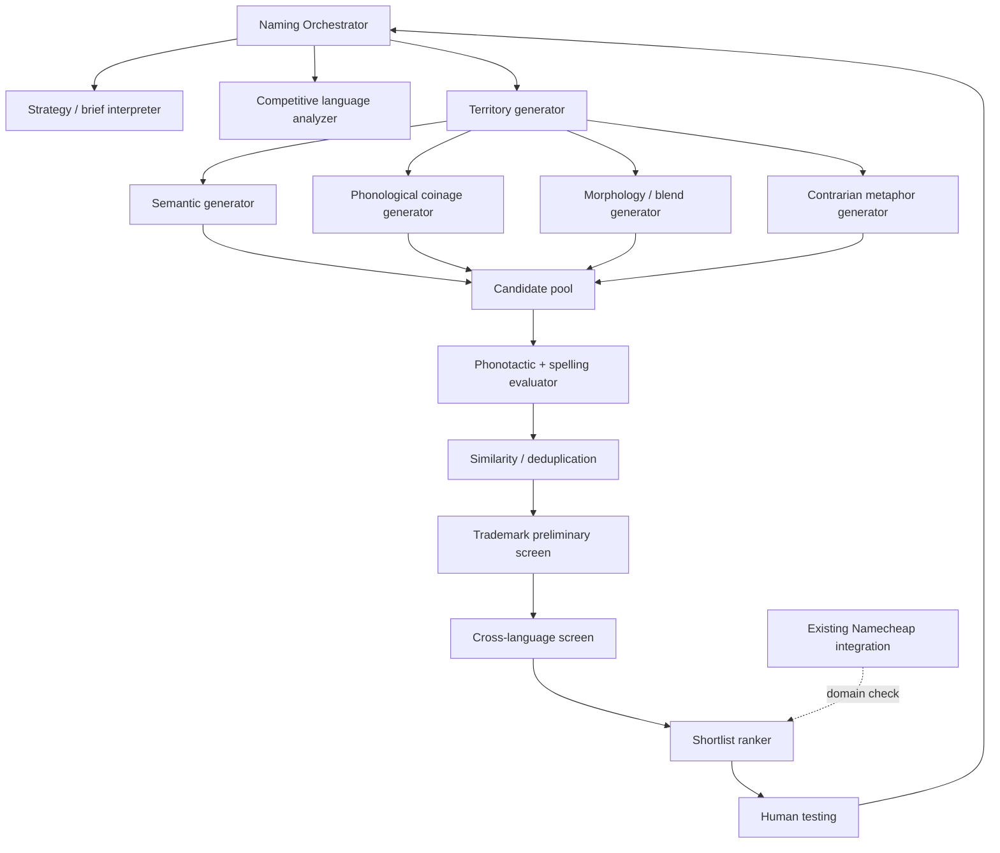
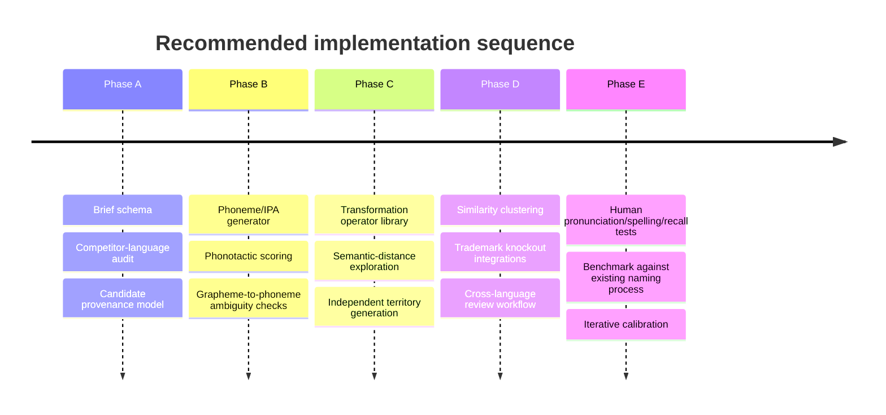

> **Research provenance - 9 November 2026.** User-supplied deep-research report `sass-namingdeep-research-report.md`, retained here as an evidence and design input. Original conversation-only citation tags have been omitted because they are not permanent links; academic/source claims require independent verification before being cited as established. Practitioner processes are not scientific validation. The transformation graph, agent architecture and test protocol are proposed methods, not proven performance results. This document proposes **no replacement for the existing Namecheap availability integration**.

# Research Foundation for an Advanced SaaS and Technology Naming Agent

## Executive findings

This report follows the attached research brief rather than the generic “deep-research tool” interpretation in the initial request. The working assumptions are therefore: the target is an AI specialist for naming SaaS applications and technology platforms; domain availability is handled separately through the existing Namecheap integration; the priority is original, memorable, naturally pronounceable names with predictable spelling; and the present task is research and agent specification, **not implementation**. 

The strongest conclusion is that excellent naming is not primarily a synonym-generation problem. Professional naming firms publicly describe a process that combines strategic positioning, multiple independent creative territories, very large candidate pools, progressive screening, linguistic/cultural checks, legal screening and contextual evaluation. Catchword says a project typically produces *thousands* of candidates; Lexicon explicitly combines creative work with linguistic, cognitive-science and research methods; Igor starts with competitive analysis and positioning; and NameStormers separates discovery, ideation, screening, presentation, refinement and testing. These are practitioner descriptions rather than experimentally validated “recipes,” but their convergence is significant. 

The psycholinguistic evidence strongly supports several components of that practice. High-probability phonotactic sequences tend to feel more word-like and are easier to maintain or reproduce than low-probability sequences; sound-to-spelling consistency can improve memory for auditorily presented novel brand names; perceptual or pronunciation fluency affects recall and judgments; and sound symbolism can systematically bias associations even when words are invented. 

Sound symbolism is real, but it should be used as a weak-to-moderate design constraint rather than a deterministic decoder. The bouba/kiki correspondence has been demonstrated across speakers of 25 languages and multiple writing systems, and experimental work finds associations between phonetic structure and attributes such as size. However, the effect is context-sensitive, and newer work shows that higher-level social or contextual cues can attenuate or reverse low-level sound-symbolic effects. 

For this agent, **phonological generation should precede or run in parallel with orthographic generation**. A good invented name is better represented internally as something like `/ˈveɹ.ə.loʊ/` plus possible spellings than as an arbitrary sequence such as `Veralo`. This allows the system to reason about syllables, stress, phonotactics, consonant clusters, auditory confusability and spelling ambiguity before typography biases judgment. Research showing that phonotactic probability affects wordlikeness and that inconsistent sound-to-spelling mapping harms memory gives this architecture a defensible empirical basis. 

The highest-value creative mechanism is not one transformation but a **transformation graph**: semantic territories → root pools → phonological mutations → morphological operations → blends → sound-preserving respellings → semantic-distance jumps → recombination. This approach is consistent with computational naming research that treats creative naming as a constrained generation problem rather than unconstrained word invention. 

A naming score should not pretend to predict commercial success. It can reliably reject obvious weaknesses and prioritize human testing, but memorability, pronunciation, spelling and associations should ultimately be measured behaviorally. Practitioner guidance also supports delayed recall and contextual testing rather than simple “which name do you like?” voting. 

The recommended system is therefore a **hybrid architecture**: one orchestrating naming agent, deterministic linguistic/computational tools, specialist generation passes operating independently, and explicit human/legal escalation. There is no evidence that a swarm of autonomous agents is intrinsically superior. Independent ideation is useful because it reduces convergence and anchoring; tool specialization is useful because phonotactics, corpus search and trademark similarity are better treated as structured analyses than as free-form language-model opinion. This architecture is a research-derived proposal, not an externally validated industry standard. 

## Evidence base: professional practice, linguistic science and technology brands

### What professional naming firms actually disclose

| Organisation | Publicly documented practice | What should be copied into the agent | Evidence status |
|---|---|---|---|
| Lexicon Branding | Strategy, linguistic/cognitive science, proprietary software, research, trademark and linguistic consideration; advises avoiding groupthink | Independent creative passes; sound/structure/semantics assessed separately | Practitioner method/vendor claim  |
| Catchword | Discovery → naming parameters → thousands of candidates → prescreening → linguistic/cultural analysis | Generate broadly before aggressive filtering; explicit naming styles/territories | Practitioner method  |
| Igor | Competitive analysis → positioning → name development → trademark → creative/testing | Competitive-name landscape before ideation | Practitioner method  |
| NameStormers | Discover → ideate → screen → pitch → refine → test | Iterative feedback, contextual presentation and delayed recall testing | Practitioner method  |

A useful distinction is that agencies disclose **workflow**, not their complete generative recipes. Claims about secret proprietary algorithms, exact candidate counts outside what an agency itself states, or the reasons a particular agency generated a particular famous name should not be inferred. Catchword explicitly states that thousands of names are developed, while Lexicon says it has a proprietary “engineering layer”; neither disclosure licenses speculation about the unreleased mechanics inside those systems. 

The convergent professional pattern is therefore more important than any single firm's branding vocabulary: understand the business, map competitors, define multiple naming directions, generate far more candidates than will ever be shown, screen progressively, evaluate names in context, and reserve legal and linguistic diligence for a manageable shortlist. 

### What the science can and cannot support

**Phonotactics and wordlikeness.** English speakers possess probabilistic knowledge about which sound sequences normally occur in English. High-probability sequences are processed differently from unlikely ones, and phonotactic probability contributes to perceived wordlikeness and nonword recall. This explains why two equally novel strings can feel radically different: an invented form can be unfamiliar while still conforming to learned language statistics. 

**Sound-to-spelling predictability.** Experimental work on fictitious brands found better memory where auditory forms had more consistent spelling mappings. This is particularly relevant to referral-driven SaaS: the desired property is not merely “easy to pronounce when read” but also “likely to be typed correctly after being heard.” 

**Processing fluency.** Easier-to-process names can improve recall or evaluations in some conditions. Difficult pronunciation can increase perceived unfamiliarity or risk, although in some contexts that same disfluency can imply excitement or novelty. The practical implication is not “always choose the easiest possible word”; it is “do not introduce friction accidentally.” 

**Sound symbolism.** Front/back vowels, stops/fricatives and other phonetic features can bias perceived attributes, and sound-symbolically congruent nonword–meaning pairings can receive a memory advantage. The bouba/kiki family of findings is unusually robust cross-culturally. But individual phonemes do not possess fixed marketing meanings, so a naming agent should treat these effects probabilistically. 

**Phonesthemes.** Recurrent sound clusters such as English `gl-`, `sn-` and similar patterns can acquire fuzzy semantic associations across families of words. Recent brand research reports that congruent phonesthemic invented names can improve processing fluency and consumer response. They are promising as one generation mechanism, not as universal semantic atoms. 

**Repetition and prosody.** Research on phonetic repetition in brands found positive affect when repeated sound structure was spoken aloud, supporting controlled use of alliteration, rhyme, consonance and rhythmic symmetry. Again, this is a tendency, not a guarantee. 

### Lessons from technology names

Technology history provides useful counterexamples to formulaic naming advice. Google is based on *googol*, with the company's own history linking the name to the scale of information it intended to organize. The alteration made the form proprietary-looking without destroying pronounceability. 

Zillow was deliberately constructed from the ideas of “zillions” of data points and “pillow/home,” according to co-founder Rich Barton. More importantly for platform naming, Barton said they wanted a name flexible enough for the business to move in directions they could not yet predict. That supports semantic breadth as a platform criterion. 

Spotify is a useful warning against retrospective mythology. Spotify's own 2026 account says the word emerged essentially by accident during founders' ideation, and Martin Lorentzon has separately described it as a misheard suggestion. The later “spot + identify” story should therefore not be treated as its actual etymology. 

Slack illustrates the value—and danger—of backronym-like explanations. Stewart Butterfield used “Searchable Log of All Communication and Knowledge,” but has also described multiple meanings around the ordinary word *slack*. The memorable real-word form came first or at least mattered independently of the expansion; the acronym should not be treated as proof that acronym construction creates strong names. 

Asana is a borrowed existing word associated with yoga posture, chosen in a company whose founders publicly discussed mindfulness, flow and complementary stability/activity. It demonstrates that conceptual metaphor and linguistic borrowing can create category distance without needing an invented form. 

Twilio is an example of a coined phonetic form: Jeff Lawson has described the name as completely invented while looking for words that sounded somewhat telephone-like. That is precisely the type of sound-first semantic suggestion an advanced naming agent should be able to generate. 

Datadog demonstrates arbitrary/internal-reference naming. Co-founder Olivier Pomel has explained that production servers at an earlier company were named after dogs and database machines became “data dogs”; the name therefore emerged from an internal metaphor rather than a conventional category descriptor. 

Vercel demonstrates the legitimate role of renaming. The company publicly announced its change from ZEIT to Vercel in 2020; external interviews with founder Guillermo Rauch describe issues around the earlier identity and the transition. It is safer to treat the naming rationale beyond those documented statements cautiously. 

Zabbix is particularly useful because the name is essentially coined rather than semantically transparent; founder Alexei Vladishev has described the earlier internal name as something closer to “Sysmon,” while interviews indicate that Zabbix was preferred partly because it sounded good across languages. It demonstrates the strategic shift from a generic descriptive label toward an ownable phonological object. 

Stripe is a counterexample to elaborate semantic engineering. Patrick Collison has repeatedly described naming as difficult and the eventual choice as emerging after extensive brainstorming rather than from an intricate naming theory. This matters: strong names can be recognized through disciplined selection even when their origin is mundane. 

The common pattern is therefore **not** a suffix, syllable count or semantic formula. Successful technology names span real words, modified words, blends, borrowings, internally meaningful arbitrary terms and pure coinages. What they more often share is a manageable spoken form, enough distinctiveness to become a unique identifier, and semantic space broad enough to accumulate meaning over time. The brand examples do not prove that the names caused company success. 

## Naming methodology encyclopaedia and phonetic construction framework

The following taxonomy should become the agent's **operator library**. Each operator should be callable independently and composable with others.

| Technique | Mechanism and foundation | Good uses | Failure mode | Agent operation |
|---|---|---|---|---|
| Portmanteau | Fuse semantic/phonological material from two roots | Product with two complementary ideas | Obvious “Frankenword”; awkward junction | Search multiple overlap points; optimize boundary phonotactics |
| Morphological substitution | Replace prefix/root/suffix while retaining a familiar pattern | New category with familiar cognitive frame | Fashionable suffix copying | Parse morphemes, substitute semantically distant alternatives |
| Clipping/compression | Remove unstressed or redundant syllables | Long compounds and technical terms | Cryptic abbreviation | Generate phonologically legal shortened variants |
| Phoneme substitution | Change one or more sounds while retaining contour | Near-familiar coinages | Trademark proximity; gimmickry | Mutate onset/nucleus/coda under edit-distance constraints |
| Phonetic respelling | Preserve pronunciation while changing graphemes | Ownable visual form | Hear-to-spell failure | Restrict to common grapheme–phoneme mappings |
| Blend by overlap | Merge roots sharing phoneme sequences | Smooth coinage | Meaning becomes invisible | Operate on IPA strings, not letter strings |
| Root/etymon recombination | Combine Greek, Latin, Germanic or other roots | Scientific/developer platforms | Pretentious or opaque | Verify root meaning before use |
| Semantic metaphor | Name via analogous object/action | Broad platform brands | Cliché metaphor families | Traverse concept graph beyond first-order associations |
| Metonymy | Name by adjacent concept rather than direct function | Workflow/infrastructure | Too subtle | Generate user, artifact, place, action, outcome adjacencies |
| Semantic inversion | Use contradiction or oppositional framing | Challenger brands | Confusion without context | Generate antonym/paradox territory then test interpretation |
| Arbitrary real word | Use unrelated ordinary word | Platform/company identity | Crowded trademark field | Favor uncommon but pronounceable nouns |
| Borrowing | Import suitable foreign-language term | Global/abstract concepts | Mispronunciation/cultural misuse | Native-speaker validation mandatory |
| Transliteration adaptation | Render sound into target orthography | International extensions | Multiple competing spellings | Model target-language phoneme inventories |
| Anagram/partial anagram | Rearrange root letters | Hidden connection | Usually produces ugly strings | Reject unless phonotactic score survives |
| Spoonerism | Swap initial sounds/syllables | Playful products | Novelty/gimmick | Use selectively, not core generator |
| Phonesthemic construction | Seed with sound cluster carrying fuzzy association | Sensory/emotional implication | Overclaiming meaning | Treat as probabilistic association only |
| Sound-symbolic construction | Manipulate vowel/consonant features | Size, speed, softness etc. | Pseudoscientific determinism | Use as weak reranking feature |
| Reduplication | Full/partial repeated syllables | Friendly, conversational tools | Childish feel | Vary ablaut/reduplicative pattern |
| Rhyme/assonance/consonance | Repeat acoustic pattern | Memorability, oral spread | Jingle-like triviality | Score rhythm and repetition |
| Stress-pattern engineering | Alter syllable prominence and cadence | Making coinages feel lexical | Unstable pronunciation | Prefer one dominant stress parse |
| Compound truncation | Combine shortened semantic roots | B2B/SaaS | Generic “tech-word soup” | Penalize overused root families |
| Backronym | Find phrase after pronounceable token exists | Internal mnemonic | Forced corporate jargon | Generate name first, expansion second |
| Pronounceable acronym | Initial letters intentionally form a spoken word | Institutional/platform naming | Constraints destroy creativity | Only use when phrase is independently natural |
| Phonetic reconstruction | Start from target sound, create unrelated spelling/root story | Highly distinctive coinages | Orthographic confusion | Generate sound first; rank spellings |
| Semantic-distance jump | Deliberately move 2–4 associations from category | Crowded SaaS markets | Connection becomes too obscure | Graph-walk through concepts before naming |
| Corpus rarity mining | Mine low-frequency but interpretable words/morphemes | Finding underused territory | Archaic/negative senses | Corpus + dictionary + sense checks |
| Prosodic templating | Generate into patterns such as CVCV, CV.CVC, trochee | Natural-sounding coinages | Homogeneity | Maintain a portfolio of templates |
| Analogy mutation | Abstract structure from a word without copying it | Natural lexical feel | Produces near-competitor names | Copy phonological pattern, not lexical material |
| Subtractive derivation | Remove internal phonemes/morphemes from a source | Crisp modern forms | Vowel-starved startup cliché | Penalize illegal/ambiguous clusters |
| Rebracketing | Change perceived boundary of words/morphemes | Surprising blends | Hard to explain | Test multiple segmentation hypotheses |
| Echoic/ideophonic formation | Construct sound with expressive acoustic character | Dynamic/creative products | Cartoonishness | Restrict to briefs seeking energy/play |
| Controlled neologism | Generate directly from phonotactic grammar | Maximum originality | Meaningless random-string output | Require semantic anchor + wordlikeness threshold |

The evidence behind these operators varies. Phonotactics, processing fluency, sound symbolism and spelling consistency have experimental support; metaphor, morphology, semantic distance and transformation methods are linguistic/creative tools whose effectiveness in commercial naming is less directly experimentally established. 

### A reusable phonetic construction model

For an English-oriented SaaS coinage, the agent should represent a candidate as:

`phonemes → syllabification → stress → likely spellings → semantic cues`

rather than:

`letters → imagined pronunciation`.

A candidate-generation grammar can use common structures such as:

| Template | Abstract form | Typical effect |
|---|---|---|
| CVC | `/vɛl/` | Compact, hard-edged |
| CVCV | `/ˈnɑ.voʊ/` | Open, easily segmented |
| CV.CVC | `/ˈlaɪ.vən/` | Familiar two-syllable rhythm |
| CCV.CV | `/ˈkluː.roʊ/` | Distinctive onset, still pronounceable |
| CV.CVC.CV | `/məˈrɛ.loʊ/` | Softer platform-like form |
| CVC.CVC | `/ˈvɛr.dɪk/` | Denser/technical character |

The strings above are structural examples, **not recommended brands and not trademark-cleared**.

The scoring layer should evaluate at least: permissible onset/coda clusters, phoneme bigram/trigram probability, syllable count, stress ambiguity, consonant-cluster difficulty, number of plausible pronunciations, number of plausible spellings after hearing, auditory distance from major competitors, and whether the sound profile matches or deliberately contrasts with the desired personality. Phonotactic probability and wordlikeness are empirically related, while spelling consistency is relevant to memory. 

The optimal range is **familiar enough to parse, unfamiliar enough to own conceptually**. Excessively high lexical similarity risks genericness or collision; excessively low phonotactic probability produces “random-letter” aesthetics. This is a design inference grounded in the wordlikeness and brand-distinctiveness literature rather than a known universal threshold. 

## Advanced naming engine and worked examples

The recommended system should deliberately generate *diversity before quality convergence*. Professional practice supports large candidate pools and separate creative directions, while computational naming work demonstrates the feasibility of combining semantic and linguistic constraints algorithmically. 



### The transformation graph

For every semantic seed, the engine should create descendants through multiple routes rather than performing one blend. A seed such as **signal** might produce conceptual neighbours (pulse, trace, beacon), metonyms (echo, channel, carrier), physical analogies (current, wave), roots from other languages, phonological skeletons, clipped forms and newly coined descendants. Each promising descendant becomes a new node that can undergo further operations.

The crucial anti-LLM mechanism is **branch separation**. A model that sees its previous ten suggestions tends to produce stylistic siblings. Separate generation passes should therefore receive the brief and territory independently, without seeing candidates from other branches. Candidate merging occurs only after generation.

An effective generation cycle is:

1. Build the competitor corpus and identify overrepresented semantic roots, suffixes, initial letters, syllable structures and phonological families.
2. Create at least four meaningfully different territories, including one deliberately remote/contrarian territory.
3. Build large concept/root pools for each territory.
4. Convert selected concepts into phoneme sequences.
5. Apply multiple transformation operators to every seed.
6. Generate plausible spellings from the phonology.
7. Reject phonotactically weak, spelling-ambiguous, generic or competitor-like candidates.
8. Cluster survivors by phonetic and semantic similarity so the final list is diverse rather than twenty variants of one idea.
9. Run preliminary trademark and cultural screening.
10. Test humans on pronunciation, spelling and delayed recall.

That sequence synthesizes professional workflows and psycholinguistic findings; its exact implementation is proposed rather than experimentally validated as a complete system. 

### Worked SaaS examples

These examples demonstrate process only. **No candidate below has been checked for domains, company use or trademark availability.**

| Brief | Territory | Transformation | Illustrative candidate | Why it demonstrates the method |
|---|---|---|---|---|
| AI incident-response platform | restoring systems / return to stable state | semantic-distance jump → phoneme simplification | **Reloom** | Suggests re-forming/reweaving without literally saying “incident” |
| Developer observability tool | trace / echo / residue | conceptual metonymy → compact coinage | **Echren** | Begins from “echo” but avoids obvious `-ly/-io/-ify` SaaS form |
| Workflow automation | continuity / handoff | metaphor → clipped blend | **Relayne** | Speech-first connection to “relay” with new lexical contour |
| Research knowledge platform | synthesis / joining evidence | root recombination → prosodic smoothing | **Synvera** | Semantic anchor in synthesis, but designed as a broader platform name |
| Privacy infrastructure | boundary / shelter | semantic inversion and abstraction | **Veilor** | Suggests protection without direct “secure/privacy” vocabulary |
| Team planning product | shared orientation | metaphor → sound-led mutation | **Northa** | Uses orientation metaphor rather than task/project terminology |

A competent agent should **not** stop at such a list. Each output needs lineage: territory, source roots, phonological form, transformations applied, expected pronunciation, alternative mispronunciations, hear-to-spell risks, closest competitor sounds and reasons for survival. That provenance makes regeneration possible rather than relying on subjective “vibes.”

A useful internal record might look like:

```text
candidate: Synvera
phonology: /sɪnˈvɛrə/
territory: synthesis / evidence joining
operators:
  - semantic root: synthesis
  - clipping: syn-
  - arbitrary phonological extension: -vera
intended stress: second syllable
likely misspellings: Sinvera, Synverra
risks:
  - verify existing marks
  - "vera" associations require multilingual check
status: exploratory only
```

## Competitive screening, trademark risk and candidate evaluation

Trademark screening must consider more than exact spellings. UK IPO guidance requires comparison of visual, aural and conceptual similarities and the similarity of goods/services, with likelihood of confusion assessed globally. USPTO guidance likewise stresses that marks can conflict because they are similar in sound, appearance, meaning or overall commercial impression when goods or services are related. EUIPO guidance also compares marks visually, aurally and conceptually. 

WIPO's Global Brand Database can search participating trademark collections and supports name, image and other searches, but WIPO itself advises checking national or regional registers because its coverage may be incomplete. For the target agent, WIPO, UK IPO, EUIPO and USPTO searches should therefore be treated as **preliminary clearance**, not legal approval. 

The UK IPO explicitly advises obtaining professional advice where a similar mark exists. Legal escalation should therefore occur for finalists, especially where a phonetic neighbour operates in related software/services, where an earlier mark is distinctive or famous, or where proposed international use creates multiple jurisdictional questions. 

The automated screen should create variants beyond simple string edit distance:

`candidate → IPA pronunciations → homophones → near-homophones → spelling variants → semantic equivalents → trademark searches by relevant classes/services`.

This is important because official trademark frameworks expressly recognize aural and conceptual similarity, not simply identical text. 

International screening should include native-speaker review for unintended meanings, pronunciation difficulty and cultural associations. Catchword describes using multiple native experts per language in its own linguistic-screening service; that is practitioner methodology rather than a regulatory standard, but it illustrates why automatic translation alone is inadequate. 

### Candidate evaluation model

Avoid a single pseudo-scientific score such as “87.4/100.” A more defensible system uses **hard rejection gates**, ordinal assessments and real behavioral measurements.

| Dimension | Automated estimate | Human test | Decision role |
|---|---|---|---|
| First-sight pronunciation | pronunciation-model agreement; number of plausible parses | ask participants to read name aloud | Hard gate for severe ambiguity |
| Hear-to-spell | grapheme probabilities; predicted alternate spellings | play audio, collect typed spelling | Major ranking criterion |
| Immediate recall | limited proxy | unaided recall after distraction | Ranking |
| Delayed recall | no credible synthetic substitute | recall after 24–72h | Strong validation |
| Distinctiveness | competitor phonetic/semantic distance | “what does this remind you of?” | Hard/soft gate |
| Associations | semantic model exploration | open-ended association task | Risk + positioning |
| Verbal referral | articulation/spelling proxies | “tell another person about it” task | Strong criterion |
| Commercial credibility | weak model prior | target-buyer judgment in context | Human validation |
| Platform extensibility | semantic narrowness analysis | stakeholder scenario testing | Strategic criterion |
| Typographic robustness | string/shape heuristics | design exploration | Secondary criterion |
| Linguistic originality | transformation lineage + corpus rarity | expert review | Diversity criterion |
| Trademark risk | automated knockout | attorney review | Mandatory escalation |

Delayed recall is especially valuable because practitioner experience recommends checking what people remember after time has elapsed, while memory research shows phonotactic and sound-meaning characteristics can affect novel-word retention. 

A human test should not begin with “Which name do you like?” Instead, expose each candidate in realistic product context, collect first pronunciation, remove it, test recall, play its pronunciation and test spelling, then gather unaided associations. Only afterward should preference be requested. This minimizes the risk that subjective liking dominates more diagnostic measures; this procedure is a recommended synthesis rather than a standardized validated naming protocol. 

## AI naming-agent specification and implementation roadmap

### Recommended architecture

The most practical architecture is a **single orchestrator with isolated specialist passes and deterministic tools**.



The specialists need not be autonomous “agents” in the organizational sense. Independent context windows or generation calls are enough to prevent anchoring. Deterministic tooling should handle IPA conversion, corpus frequency, phoneme/grapheme statistics, clustering, competitor distance, trademark queries and Namecheap availability. Language models should handle semantic exploration, metaphors, transformations, rationale and synthesis.

### Required inputs

The naming brief should require: product purpose, target user, buyer/user distinction, core benefits, desired and undesired personality, market/category, major competitors, geographical/language markets, product-versus-company scope, expected future expansion, preferred naming styles, prohibited concepts, required master-brand relationships and legal classes/services where known.

### Required outputs

For every serious candidate, return:

| Field | Purpose |
|---|---|
| Name | Proposed written form |
| IPA / pronunciation | Removes ambiguity |
| Stress | Captures natural spoken form |
| Territory | Prevents arbitrary rationale-writing |
| Construction lineage | Shows how it was actually generated |
| Semantic associations | Positive and negative |
| Pronunciation risks | Alternative readings |
| Hear-to-spell risks | Plausible wrong spellings |
| Competitor similarity | Phonetic, visual and semantic |
| Preliminary trademark status | Search result, never legal conclusion |
| International flags | Languages/markets needing human review |
| Platform extensibility | Whether meaning will constrain expansion |
| Confidence/evidence | What is measured vs inferred |

### Guardrails

The agent should reject or penalize:

- fashionable suffix substitution masquerading as creativity;
- vowel deletion that causes pronunciation ambiguity;
- arbitrary consonant piles;
- names that are merely competitor names with one phoneme changed;
- hidden reliance on domain availability as the naming strategy;
- fabricated etymologies;
- unsupported claims that a phoneme “means” a particular personality trait;
- candidates that require a paragraph to explain pronunciation;
- culturally borrowed terms whose meaning has not been verified;
- legal statements such as “trademark safe.”

Research on vowel-less naming itself cautions that removing vowels can negatively affect consumer response, while spelling-consistency evidence gives a stronger reason to penalize forms that create multiple plausible spellings. 

### Build sequence



The first evaluation benchmark should compare the new agent against the repository's existing naming approach on a fixed set of historical briefs. Blind reviewers should judge output diversity and strategic fit, while separate participants perform pronunciation, audio-to-spelling and delayed-recall tasks. The agent should only be considered improved if it produces **more usable surviving candidates per brief**, not merely more raw suggestions. This is a proposed evaluation design.

The principal implementation priority should therefore be **candidate-generation diversity plus linguistic rejection**, not trademark automation or elaborate scoring. Trademark search can remove candidates, but it cannot create strong ones; numerical ranking cannot rescue a homogeneous candidate pool.

## Source register and evidence hierarchy

The following sources are the most consequential foundation for implementation. The original research supplied conversational citations, which are not portable to this repository. Entries below identify the reported sources for subsequent verification.

| Source | Date | Quality | Main conclusion supported |
|---|---:|---|---|
| UK IPO, *Manual of Trade Marks Practice*  | current guidance | **Primary / official** | Visual, aural, conceptual and goods/services similarity; global confusion assessment |
| USPTO, *Likelihood of confusion*  | current guidance | **Primary / official** | Similar sound, appearance, meaning and related goods can create conflict |
| EUIPO Trade Mark Guidelines  | current guidance | **Primary / official** | Structured visual/aural/conceptual comparison |
| WIPO, Global Brand Database guidance  | current | **Primary / official** | International preliminary search capability and coverage limitations |
| Nielsen & Rendall et al., cross-cultural bouba/kiki study  | 2021 | **Peer reviewed** | Sound–shape correspondence robust across many languages/scripts |
| Sidhu et al., sound symbolism and associative memory  | 2017 | **Peer reviewed / open** | Congruent sound symbolism can improve nonword–meaning memory |
| Vitevitch et al., phonotactic probability/wordlikeness research  | 1999–2011 | **Peer reviewed** | Language statistics influence nonword wordlikeness and processing |
| Gathercole et al., phonotactic influence on short-term memory  | 1999 | **Peer reviewed** | High-probability nonwords gain recall advantage |
| Brand spelling and auditory memory study  | 2012 | **Peer reviewed** | Consistent sound-to-spelling mapping improves brand-name memory |
| Lowrey & Shrum, phonetic symbolism and preference  | 2007 | **Peer reviewed** | Vowel characteristics can affect brand-name preference |
| Klink-related sound-symbolism literature  | 2004 | **Peer reviewed** | Brand phonetics can influence product judgments |
| Özbal & Strapparava, computational creative naming  | 2012 | **ACL research** | Naming can be formalized as computational constrained creativity |
| Catchword naming methodology  | current | **Established practitioner** | Large candidate pools, parameters, prescreening and linguistic checks |
| Lexicon naming process  | current | **Established practitioner** | Separation of strategy, creative work, linguistic science and research |
| Igor naming process  | current | **Established practitioner** | Competitive analysis and positioning before generation |
| NameStormers process/testing guidance  | current | **Established practitioner** | Progressive screening and contextual/delayed-recall testing |
| Google corporate history  | current historical account | **Primary company source** | Documented Google name origin |
| Spotify corporate account  | 2026 | **Primary company source** | Spotify's name was essentially accidental/misheard rather than planned portmanteau |
| Datadog founder/company material  | 2013 onward | **Primary/founder interview** | Internal server metaphor behind Datadog |
| Vercel rebrand announcement  | 2020 | **Primary company source** | Confirmed ZEIT → Vercel rename |
| Asana/founder account  | 2013 | **Founder interview** | Yoga-derived name and conceptual association |

The evidence hierarchy for the eventual agent should be explicit: **official legal rules and peer-reviewed experimental findings** should control factual constraints; replicated linguistic findings should influence generation and filtering; professional naming firms should inform workflow; individual brand stories should supply examples and counterexamples; and the proposed transformation engine, scoring architecture and orchestration design should remain labeled as **derived methodology** until benchmarked.

The central design principle that emerges from the research is straightforward: **generate meaning broadly, construct sound deliberately, spell conservatively, filter aggressively, and test humans on what they actually say, hear, spell and remember.** This gives the proposed naming agent a stronger foundation than either conventional brainstorming or unconstrained LLM name generation while avoiding the false precision of treating branding as a solved linguistic equation. 